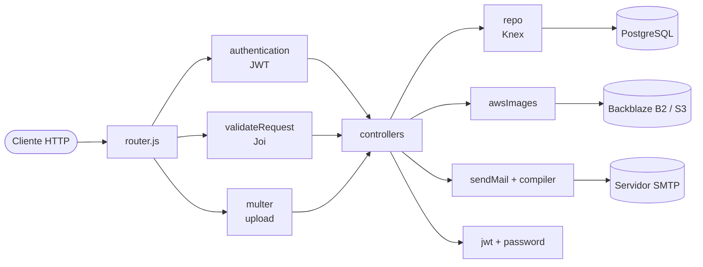
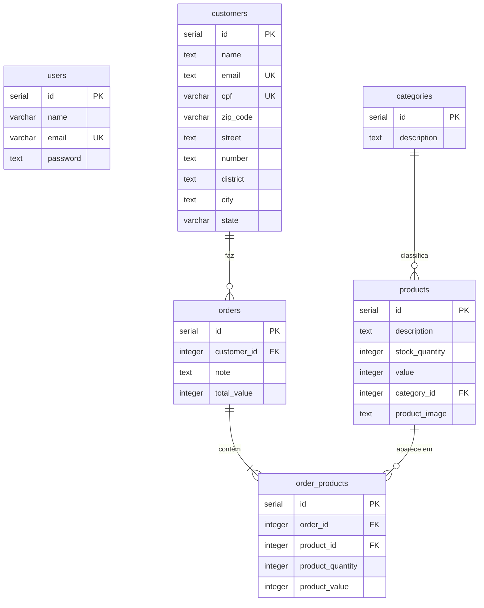

# Sale Point API

Esta foi a minha primeira API, desenvolvida em 2023.

É uma API REST de ponto de venda: gerencia usuários, categorias, produtos com imagem, clientes e pedidos, com baixa de estoque a cada venda e envio de e-mail de confirmação para o cliente.

## Stack

- Node.js + Express
- PostgreSQL com Knex como query builder
- JWT (`jsonwebtoken`) para autenticação, com token válido por 1 hora
- bcrypt para hash de senhas
- Joi para validar body, parâmetros de rota e query string
- Multer + AWS SDK para upload de imagens em storage compatível com S3 (Backblaze B2)
- Nodemailer + Handlebars para o e-mail de confirmação de pedido

## Funcionalidades

- Cadastro e login de usuários. Com exceção de cadastro, login e listagem de categorias, todas as rotas exigem token.
- Produtos com imagem opcional enviada via `multipart/form-data`. Ao editar ou excluir um produto, a imagem antiga é removida do bucket.
- Um produto que já aparece em algum pedido não pode ser excluído.
- Clientes com e-mail e CPF únicos. CPF e CEP aceitam formatos com ou sem máscara e são salvos só com os números.
- Pedidos: a API agrupa itens repetidos, confere se cada produto existe e tem estoque, dá baixa no estoque, calcula o total, guarda o preço unitário de cada item no momento da venda e envia o e-mail de confirmação.
- Valores monetários são armazenados em centavos (inteiros).

## Arquitetura

O código está dividido em camadas: as rotas passam pelos middlewares de autenticação e validação, os controllers concentram a regra de negócio e os repositórios fazem o acesso ao banco com Knex. Integrações externas ficam em `services`.



```
src/
├── config/        # conexões: Knex, S3, Nodemailer, Multer
├── controllers/   # regras de negócio de cada recurso
├── middlewares/   # autenticação JWT e validação com Joi
├── repo/          # consultas ao banco
├── schema/        # schemas Joi
├── services/      # imagens, e-mail, JWT e senhas
├── templates/     # template HTML do e-mail de pedido
├── router.js
└── index.js
```

## Modelo de dados



O `dump.sql` já cadastra nove categorias iniciais.

## Como rodar

### Requisitos

- Node.js 18 ou superior
- PostgreSQL
- Um bucket compatível com S3 (usei o Backblaze B2) para as imagens
- Um servidor SMTP para os e-mails (para testes, o Mailtrap funciona bem)

### Passo a passo

1. Clone o repositório e instale as dependências:

   ```bash
   git clone https://github.com/renanabade/sale-point-api.git
   cd sale-point-api
   npm install
   ```

2. Crie o arquivo `.env` a partir do exemplo e preencha as variáveis:

   ```bash
   cp .env.Example .env
   ```

   | Variável | Uso |
   | --- | --- |
   | `PORT` | Porta da API (padrão 3000) |
   | `JWTPASSWORD` | Segredo usado para assinar os tokens |
   | `DB_HOST`, `DB_PORT`, `DB_USER`, `DB_PASS`, `DB_NAME` | Conexão com o PostgreSQL |
   | `KEY_ID`, `APP_KEY` | Credenciais do bucket |
   | `ENDPOINT_S3` | Endpoint S3 do provedor |
   | `BLACKBLAZE_BUCKET` | Nome do bucket |
   | `MAIL_HOST`, `MAIL_PORT`, `MAIL_USER`, `MAIL_PASS` | Servidor SMTP. `MAIL_USER` também é usado como remetente |

3. Crie o banco e importe o `dump.sql`. O dump cria um banco chamado `sales_point`, então use esse nome em `DB_NAME`:

   ```bash
   createdb -U postgres sales_point
   psql -U postgres -d sales_point -f dump.sql
   ```

   Como o banco já foi criado no passo anterior, o `CREATE DATABASE` da primeira linha vai acusar que ele já existe. Pode ignorar, o restante do script roda normalmente.

4. Suba a API em modo de desenvolvimento:

   ```bash
   npm run dev
   ```

   A API fica disponível em `http://localhost:3000` (ou na porta definida em `PORT`).

## Endpoints

Rotas autenticadas esperam o header `Authorization: Bearer <token>`, com o token retornado pelo login.

| Método | Rota | Auth | Descrição |
| --- | --- | --- | --- |
| GET | `/category` | Não | Lista as categorias |
| POST | `/user` | Não | Cadastra um usuário |
| POST | `/login` | Não | Faz login e retorna o token |
| GET | `/user` | Sim | Retorna o usuário logado |
| PUT | `/user` | Sim | Atualiza nome, e-mail e senha do usuário logado |
| POST | `/product` | Sim | Cadastra um produto (multipart, imagem opcional) |
| PUT | `/product/:id` | Sim | Atualiza um produto (multipart, imagem opcional) |
| GET | `/product` | Sim | Lista produtos. Aceita `?category_id=` |
| GET | `/product/:id` | Sim | Detalha um produto |
| DELETE | `/product/:id` | Sim | Exclui um produto que não esteja em nenhum pedido |
| POST | `/customer` | Sim | Cadastra um cliente |
| PUT | `/customer/:id` | Sim | Atualiza um cliente |
| GET | `/customer` | Sim | Lista os clientes |
| GET | `/customer/:id` | Sim | Detalha um cliente |
| POST | `/order` | Sim | Cria um pedido, baixa o estoque e envia o e-mail |
| GET | `/order` | Sim | Lista pedidos com seus itens. Aceita `?customer_id=` |

Erros de validação retornam `400` com a mensagem do Joi no campo `message`.

### Login

`POST /login`

```json
{
  "email": "usuario@email.com",
  "password": "123456"
}
```

Resposta `200`:

```json
{
  "user": {
    "id": 1,
    "name": "Usuário",
    "email": "usuario@email.com"
  },
  "token": "eyJhbGciOiJIUzI1NiIsInR5cCI6IkpXVCJ9..."
}
```

### Cadastro de produto

`POST /product` com `multipart/form-data`. O campo `value` é em centavos.

```bash
curl -X POST http://localhost:3000/product \
  -H "Authorization: Bearer <token>" \
  -F "description=Teclado mecânico" \
  -F "stock_quantity=15" \
  -F "value=25990" \
  -F "category_id=1" \
  -F "image=@./teclado.png"
```

Resposta `201`:

```json
{
  "id": 1,
  "description": "Teclado mecânico",
  "stock_quantity": 15,
  "value": 25990,
  "category_id": 1,
  "product_image": "https://<bucket>.s3.us-east-005.backblazeb2.com/teclado.png"
}
```

### Criação de pedido

`POST /order`

```json
{
  "customer_id": 1,
  "note": "Entregar no período da tarde",
  "order_products": [
    { "product_id": 1, "product_quantity": 2 },
    { "product_id": 3, "product_quantity": 1 }
  ]
}
```

Resposta `201`:

```json
{
  "message": "Order placed successfully"
}
```

Se o cliente ou algum produto não existir, ou se faltar estoque, a API responde `400` indicando o problema e nenhum pedido é criado.
